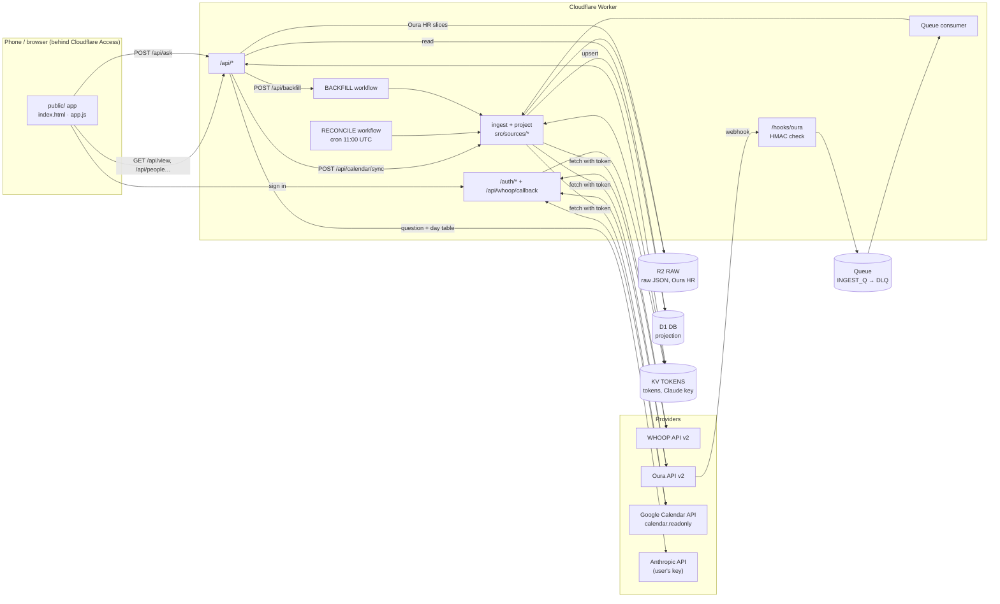
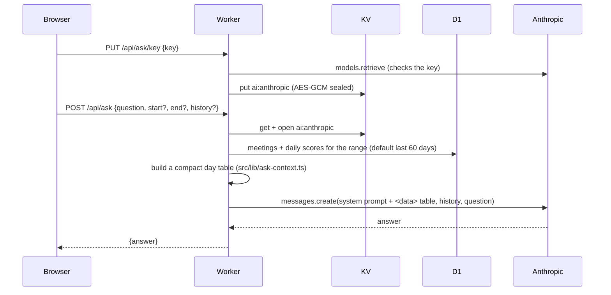

# Meetspike architecture

One Cloudflare Worker, one person per install. It pulls data from a wearable
(WHOOP or Oura) and from Google Calendar, keeps the raw JSON in R2, projects it
into D1, and serves a small phone-first web app plus a JSON API from the same
address. Cloudflare Access in front of it is the only login.

Setup steps and every setting are in the [README](../README.md). Metric
definitions are in [METRICS.md](../METRICS.md).

## Components

| Component | Where | What it does |
| --- | --- | --- |
| Worker (Hono) | `src/index.ts`, `src/routes/` | HTTP: API under `/api/*`, OAuth under `/auth/*`, webhooks under `/hooks/*`. Also the queue consumer. |
| Static app | `public/` (`ASSETS` binding) | `index.html` + `app.js` (no framework, no build step), `setup.html` first-run page, PWA manifest and icons. Served by Workers static assets; routes above run the Worker first. |
| D1 (`DB`) | `migrations/` | The queryable projection: daily scores, calendar events, attendees, sync log. |
| R2 (`RAW`) | `src/lib/r2.ts` | Append-only archive of every raw document fetched, at `<source>/<endpoint>/<documentId>/<sha256>.json`. Oura heart-rate samples live **only** here. |
| KV (`TOKENS`) | `src/lib/tokens.ts`, `src/lib/ai-key.ts` | OAuth tokens, pending sign-in state, the encrypted Claude key. |
| Queue (`INGEST_Q`) + DLQ | `src/queue/consumer.ts` | Oura webhook events: `/hooks/oura` verifies and enqueues, the consumer fetches and upserts. 5 retries, then the dead-letter queue. |
| Workflow `BACKFILL` | `src/workflows/backfill.ts` | `POST /api/backfill`: imports a window (default 30 days) from the active wearable — fixtures, Oura sandbox, or production — in retryable steps. |
| Workflow `RECONCILE` | `src/workflows/reconcile.ts` | Daily at 11:00 UTC (and `POST /api/reconcile`): re-pulls the last 7 days of the wearable and the calendar, because wearables revise sleep and recovery after publishing. |
| Anthropic API | `src/routes/ask.ts` | Only for "Ask your data", only with the user's own key. |

Source adapters live in `src/sources/<whoop|oura|calendar|plaud>/`: `client.ts`
(HTTP, auth, paging, rate limits), `endpoints.ts`, `ingest.ts` (fetch → R2 →
D1), `project.ts` (raw document → D1 rows), `fixtures.ts` (synthetic sample
data).

## Data flow

### Ingest

1. **Sign-in.** `/auth/<provider>/start` stores a short-lived state in KV
   (PKCE verifier for Oura and Google, plus the exact redirect URI sent) and
   redirects to the provider. The callback trades the code for tokens and
   writes `whoop:tokens`, `oura:tokens` or `google:tokens` to KV. Redirect URIs
   are built from the request's own origin unless `*_REDIRECT_URI` is set, so
   one install can answer on `workers.dev` and on custom domains at once.
2. **Fetch.** A backfill, the nightly reconcile, a manual calendar sync, or a
   queued webhook calls the source client with a fresh access token (refreshed
   from KV when needed; WHOOP refresh tokens are single-use). The WHOOP client
   paces itself to 100 requests/minute and 10,000/day. An Oura `403` means the
   membership lapsed and is not retried as a refresh.
3. **Archive.** Each document is canonicalised and hashed. If
   `(endpoint, documentId, hash)` is already in `raw_object`, it is skipped;
   otherwise it is written to R2 and recorded in `raw_object`.
4. **Project.** The document becomes D1 rows by upsert (wearables revise data
   after publishing, so every write is an upsert). Calendar events get a local
   day, local start/end, a kind (from title heuristics) and an after-hours flag
   (start ≥ 18:00 local), and their attendees go to `calendar_attendee`.
5. **Log.** Each run writes a `sync_log` row.

Plaud recordings (optional) arrive by `POST /api/plaud/ingest` with
`INGEST_ADMIN_SECRET`; the Worker never holds a Plaud token. See
[PLAUD.md](../PLAUD.md).

### D1 tables

| Table | Holds |
| --- | --- |
| `raw_object` | Index of every archived document: source, endpoint, document id, hash, R2 key. |
| `user_profile` | One row (`self`): time zone and profile from Oura. |
| `daily_sleep`, `daily_readiness`, `daily_activity`, `daily_stress` | Daily scores by `day` and `source` (`oura` or `whoop`; WHOOP recovery lands in `daily_readiness`). |
| `daily_strain` | WHOOP cycle strain and average/max heart rate per day. |
| `sleep_periods`, `workouts`, `sessions`, `tags` | Detail rows from the wearable. |
| `calendar_event` | Google events (and Plaud calls) with local day, times, kind, after-hours, attendee JSON. |
| `calendar_attendee` | One row per event attendee email, with display name. Person views query this. |
| `sync_log` | What ran, when, how many rows written/skipped, errors. |
| `webhook_subscription` | Oura webhook subscriptions (not registered automatically yet). |

Heart-rate samples are never inserted into D1. Endpoints that need in-meeting
heart rate read the day's archive from R2 once and slice each meeting window
from it (`src/lib/heartrate-archive.ts`).

### The join

Work happens on local day **D**; the wearable's morning **D+1** reports the
night after. Every briefing pairs day D's meetings with the D+1 scores.
"Heavy" days are 4+ meeting hours or 5+ meetings. "Your usual" is the median
over the previous 28 days. Definitions: [METRICS.md](../METRICS.md).

### KV keys

| Key | Value |
| --- | --- |
| `whoop:tokens`, `oura:tokens`, `google:tokens` | OAuth access/refresh tokens and expiry. |
| `oauth:whoop:state:*`, `oauth:state:*`, `oauth:google:state:*` | Pending sign-ins, 10-minute TTL. |
| `ai:anthropic` | The user's Claude API key, AES-GCM sealed with a key derived from `AI_KEY_SECRET`, plus its last four characters and save time. |

## API routes

All JSON, same origin as the app.

| Route | Purpose |
| --- | --- |
| `GET /api/view?date=` · `?start=&end=` | Everything one screen needs in one request. |
| `GET /api/briefing/day?date=` · `/briefing/range?start=&end=` · `/briefing/week?date=` | Day, range (≤ 92 days) and Monday–Sunday week briefings. |
| `GET /api/insights/hits?days=28` | Meetings ranked by in-meeting heart rate (Oura). |
| `GET /api/people/:email/meetings?days=60` · `/api/meetings/by-attendee?email=` | History with one person. |
| `GET /api/meetings/stressed` · `/api/meetings/sleep-impact` · `/api/metrics/daily` · `/api/sleep` | Lists and series used by the views. |
| `GET /api/health` · `GET /api/ping` | Status (connections, counts, active wearable) and a liveness check. |
| `GET /api/setup/status` | What the setup page shows: redirect URIs, which secrets exist (never values), connections. |
| `POST /api/backfill` | `{ "mode": "fixtures" \| "sandbox" \| "production", "startDay?", "endDay?" }` → starts `BACKFILL`. |
| `POST /api/calendar/sync` | `{ "mode": "live" \| "fixtures", "startDay?", "endDay?" }`. |
| `POST /api/reconcile` | Runs the nightly reconcile now. |
| `GET /api/ask/status` · `PUT /api/ask/key` · `DELETE /api/ask/key` · `POST /api/ask` | Ask your data. |
| `POST /api/plaud/ingest` | Optional Plaud call windows, admin secret. |
| `GET /auth/{whoop,oura,google}/start` | Begin sign-in. |
| `GET /api/whoop/callback` · `/auth/oura/callback` · `/auth/google/callback` | OAuth returns. |
| `GET /hooks/oura` · `POST /hooks/oura` | Oura webhook challenge and events. |

Date ranges are inclusive local days, capped at 92; a bad range is a `400`
with the reason in `error`.

## Auth model

The app has **no login of its own**. It is meant to sit behind
[Cloudflare Access](https://developers.cloudflare.com/cloudflare-one/applications/):

- **Allow (your email):** the whole host — `/`, `/setup`, `/api/*`, and the
  `/auth/*/start` routes.
- **Bypass (everyone):** the OAuth callbacks (`/api/whoop/callback`,
  `/auth/oura/callback`, `/auth/google/callback`), because the provider
  redirect carries no Access cookie; `/hooks/*`, where the HMAC signature is
  the check; `/api/plaud/*` if used, where `INGEST_ADMIN_SECRET` is the check;
  optionally `/manifest.webmanifest`, `/icons/*`, `/favicon.ico` so phones can
  install the app.

The most specific Access application wins. The front end treats a redirect or
an HTML answer from `/api/*` as an expired Access session and offers to sign
in again.

Other checks inside the Worker:

- **Oura webhooks:** `x-oura-signature` must equal uppercase hex
  HMAC-SHA256(`x-oura-timestamp` + raw body) keyed by `OURA_CLIENT_SECRET`,
  within a 5-minute window. The handler only enqueues, so it answers fast.
- **OAuth:** state is single-use and expires after 10 minutes; Oura and Google
  use PKCE (S256).
- **Secrets** are Worker secrets. `/api/setup/status` reports only whether
  each exists. The Claude key never returns to the browser beyond its last
  four characters.

## Ask flow

**What goes to Anthropic:** per day in the range — date, weekday, morning
scores (recovery/readiness, sleep, HRV, resting heart rate, WHOOP strain),
next-morning scores, meeting count, hours and after-hours count; per meeting —
local start time, title, kind, length, and up to six other attendees' display
names (or the local part of the email when there is no name). Also the
28-day "usual" medians, the heavy-day comparison, the question, and up to 12
previous chat turns sent by the browser.

**What does not:** email addresses, event descriptions or locations, raw
wearable documents, heart-rate samples, Plaud transcripts or audio, tokens.

The request goes straight from the Worker to Anthropic with the user's key
(the model is `ASK_MODEL` in `src/routes/ask.ts`; the data block is marked for
prompt caching so follow-ups are cheaper). Nothing is stored server-side
about the conversation; the browser keeps the last turns in `sessionStorage`.
Without `AI_KEY_SECRET`, `/api/ask/status` reports `available: false` and the
UI explains what to set.

## Front end and caching

`public/app.js` asks `/api/view` for one screen at a time and keeps a small
in-tab cache (memory + `sessionStorage`) so revisiting a screen is instant
while a fresh copy loads. On a full page load every cached entry is treated as
stale and refetched. `public/_headers` serves HTML, JS, CSS and the manifest
with `Cache-Control: no-cache`, so a refresh always picks up a new deploy.
There is no service worker. Icons are versioned (`?v=`) and cached for a year.

## Time zone

Day boundaries, "after hours" and "today" use `America/New_York`, except that
an Oura install uses the time zone from the Oura profile (`user_profile`) on
the server. It is not a setting yet. Making it one means:

- `src/lib/time.ts` — `IANA_FALLBACK` / `DEFAULT_TIME_ZONE`, and
  `loadTimeZone()` in `src/lib/db.ts` (used by every route and ingest path);
- default arguments in `src/lib/heartrate.ts`, `src/lib/heartrate-archive.ts`,
  `src/sources/oura/project.ts`;
- the hard-coded `timeZone` in `GET /api/health` and the week-in-review note
  in `src/sources/calendar/meetings.ts`;
- `public/app.js` (`TZ`), which needs the zone before its first request to
  pick "today";
- re-syncing the calendar afterwards, because each event's local day and
  after-hours flag are computed when it is ingested.
